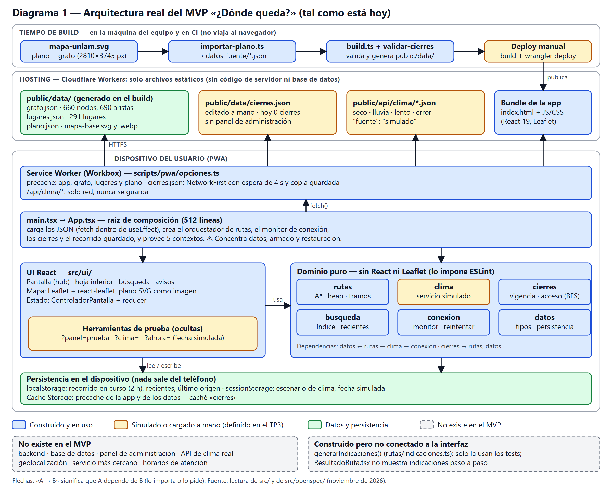
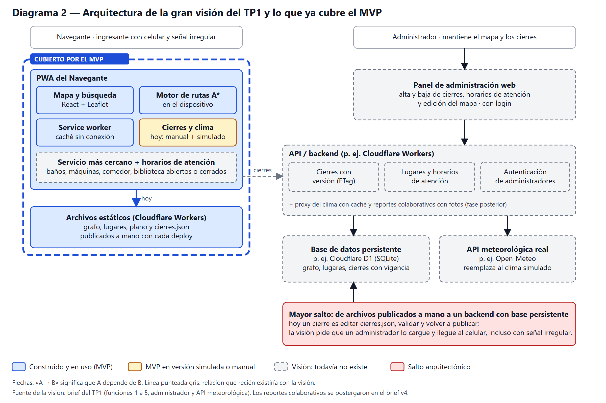

# TP6. Arquitectura del Sistema

**Equipo:** Summate — Agasi Alejo, Huergo Estefanía, Naspleda Julián, Panigazzi Agustín, Rios Cristian
**Repositorio:** <https://github.com/gadsii-unlam/gadsii-summate>
**MVP:** <https://donde-queda.donde-queda.workers.dev>
**Producto:** _¿Dónde queda?_ — aplicación web que calcula y muestra la ruta más corta entre dos puntos del campus de la UNLaM.
**Fecha de entrega:** martes 10/11/2026

---

## 1. Arquitectura real del MVP

El MVP es una **SPA de React 19 + TypeScript + Vite, sin backend**. Todo el cálculo ocurre en el teléfono: la ruta se calcula con A\* sobre un grafo de 660 nodos y 690 aristas que se descarga como JSON. Se publica como archivos estáticos en Cloudflare Workers y se instala como PWA.

Cómo leer el diagrama:

- **Componentes y responsabilidades.** `App.tsx` arma las piezas y carga los datos. `ui/` dibuja (pantalla, mapa Leaflet, búsqueda). El **dominio** (`rutas`, `clima`, `cierres`, `busqueda`, `conexion`, `datos`) no importa React ni Leaflet: lo impone una regla de ESLint (`src/eslint.config.js`, `no-restricted-imports`). El service worker de Workbox decide qué se guarda para usar sin conexión (`src/scripts/pwa/opciones.ts`).
- **Dependencias.** Van de arriba hacia abajo: la composición depende de la UI y del dominio, y la UI depende del dominio, nunca al revés. Dentro del dominio: `datos ← rutas ← clima ← conexion`, y `cierres → rutas, datos`.
- **Capas.** Build (no viaja al navegador), hosting estático y dispositivo del usuario.
- **Datos.** Grafo, lugares y plano son JSON/SVG estáticos generados en el build a partir de `mapa-unlam.svg` (`src/scripts/datos/`). No hay base de datos. Lo único que se persiste es en el dispositivo: `localStorage` (recorrido en curso, válido 2 h; recientes; último origen), `sessionStorage` (escenario de clima, fecha simulada) y la caché del service worker.
- **Construido vs. simulado (TP3).** Está construido el motor de rutas, la interfaz y la exclusión de tramos cerrados. Está **simulado** el servicio del clima (`public/api/clima/*.json`, con `"fuente": "simulado"`) y la carga de cierres, que se hace a mano en `public/data/cierres.json` y se publica con un deploy, sin panel de administración.

Dos hallazgos de la lectura del código que conviene dejar dichos: la función `generarIndicaciones()` (indicaciones paso a paso) está construida y testeada pero la interfaz no la usa; y el `design.md` de `configurar-base-app` quedó desactualizado (habla de 685 nodos y heurística Manhattan; el código tiene 660 nodos y distancia euclidiana).

## 2. Las decisiones heredadas

> **[BORRADOR — borrar este aviso al confirmar]** La consigna pide que la clasificación de _quién decidió_ la haga el equipo, no un modelo. Las columnas 2 y 3 están completadas con la evidencia del repositorio (`docs/prompts.md` línea 20, commit `113f1c1`, los `design.md` de `src/openspec/changes/`), pero **cada integrante tiene que confirmarlas o corregirlas** con lo que recuerde del TP5.

| Decisión | ¿Quién la tomó? | ¿La sostendrían hoy? | ¿Qué dato del TP2 o de la prueba del TP5 la sostiene o la contradice? |
| --- | --- | --- | --- |
| **Sin backend:** los datos del campus y los cierres son archivos estáticos publicados con cada deploy. | **La herramienta.** Claude Code (Opus 5.5) con el flujo de OpenSpec la propuso junto con las demás decisiones estructurales (`docs/prompts.md`, línea 20) y quedó en el commit `113f1c1` («SPA sin backend»). El equipo sí había decidido en el TP3 no construir un panel de administración y precargar los cierres; lo que eligió la herramienta fue el mecanismo (JSON en el repositorio + deploy). | **Para el MVP, sí. Para la visión, no.** Es lo más simple que cumple lo que había que probar. No alcanza para que alguien que no toca el código cargue un cierre. | **Sostiene:** en el TP2, 5 de 5 encuestados dijeron tener «datos móviles con señal irregular»; con todo estático y cacheable, el MVP no depende de un servidor para mostrar la ruta. **Contradice parcialmente:** en el TP5 el cierre de T2 exigió cargarlo en `cierres.json` el día anterior, correr `npm run validar-cierres`, publicar y, al terminar, retirarlo y volver a publicar (`docs/evidencia/tp5/guion-sesion.md`, línea 33). Un cierre real no se puede esperar a un deploy. |
| **La orquestación está concentrada en `App.tsx`** (512 líneas): hace los `fetch` dentro de un `useEffect`, arma el orquestador, el monitor de conexión y los cierres, restaura el recorrido guardado y provee 5 contextos. Además, algunos componentes llaman a funciones de dominio (p. ej. `ContenidoRutaApp.tsx` llama a `explicarSinRuta` y `avisoDeDesvio` dentro de `useMemo`). | **Nadie, salió así.** No hay ninguna decisión de diseño escrita sobre esto: la separación en carpetas de dominio sí fue propuesta por la herramienta, pero cómo se compone todo en un solo archivo es el resultado de ir agregando cambios de OpenSpec uno tras otro. | **Parcialmente.** El dominio está bien aislado y es testeable; lo que preocupa es que `App.tsx` es el único lugar donde se conoce todo, y cada funcionalidad nueva (usuarios, panel, sincronización) lo va a tocar. | **Ningún dato del TP2 ni del TP5 la sostiene ni la contradice.** Nadie en la prueba pudo notarla; es una decisión de comodidad de la construcción, no de los usuarios. |

Una tercera decisión de la herramienta, **PWA con funcionamiento sin conexión**, también la hubiéramos sostenido, y es la mejor respaldada por los datos: el TP2 la pedía («la consulta debería ser rápida y tolerar conectividad limitada») y en el TP5 U3 perdió la señal unos 20 s en T1 (18:02:00) y «la ruta ya cargada siguió a la vista». Que la haya elegido la herramienta no la vuelve mala; lo importante es saber que está.

## 3. La arquitectura de la gran visión

El producto completo del TP1 tiene cinco funciones: (1) mapa y ruta más corta, (2) estado de atención de los puntos de interés según día y hora, (3) búsqueda del servicio más cercano, (4) administración de caminos temporalmente cerrados por un usuario administrador y (5) rutas adaptadas al clima con una API meteorológica. Arquitectónicamente eso pide dos clientes (el Navegante, que ya existe, y un panel de administración), un backend con autenticación y una base de datos persistente. El MVP cubre la función 1 completa, la 4 y la 5 en versión manual o simulada, y nada de las funciones 2 y 3.

**El salto arquitectónico más grande** es pasar de archivos estáticos publicados a mano a un **backend con base persistente y un administrador que cargue los datos**, sin perder lo que hoy funciona: que la ruta se calcule en el dispositivo y siga a la vista con señal irregular. Todo el MVP asume que los datos cambian solo cuando el equipo publica una versión nueva; la visión asume que cambian durante el día (un cierre, el horario de un servicio) y que ese cambio llega a un celular con señal intermitente.

## 4. Las tecnologías que agregaría la visión

1. **Backend y base de datos en la misma plataforma: Cloudflare Workers + D1 (SQLite).** Para guardar cierres con vigencia, horarios de atención y administradores. **La proponemos por continuidad**: el MVP ya está desplegado en Workers (con `wrangler`), así que no habría que sumar un servidor ni una infraestructura nueva para mantener. [BORRADOR: confirmar si además pesa la familiaridad del equipo con la plataforma; si es así, declararlo acá.] Declaramos que ninguno de los TP anteriores relevó restricciones de infraestructura de la UNLaM (sistemas institucionales, políticas de acceso a datos, quién mantendría el sistema), por lo que esto queda como **supuesto a validar** y no como un argumento de contexto.
2. **API meteorológica real** (por ejemplo Open-Meteo, a verificar condiciones de uso). Reemplaza al servicio simulado. El código ya tiene la costura: `src/src/clima/servicio-simulado.ts` es lo único que habría que cambiar, y `clima/README.md` documenta cómo. El TP1 prometía adaptar la ruta al clima real «sin sensores propios ni ubicación GPS»; hoy esa promesa se prueba solo con archivos fijos.
3. **Sincronización de cierres entre el servidor y la PWA** (versión/ETag sobre el service worker que ya existe, y revalidación al abrir la app; Background Sync solo donde el navegador lo soporte). **Se justifica contra el contexto de uso del TP2:** 5 de 5 encuestados usan datos móviles con señal irregular, así que un cierre cargado por el administrador tiene que llegar aunque la conexión sea mala, y la app tiene que seguir funcionando si no llega. Además, la prueba del TP5 usó un iPhone (U1) y dos Android (U2 y U3): la sincronización en segundo plano no está disponible en todos, así que el diseño no puede depender de ella.

## 5. El componente más riesgoso

**El subsistema de cierres** (`src/src/cierres/` + `public/data/cierres.json` + la estrategia `NetworkFirst` del service worker).

- **Es donde la prueba del TP5 mostró fricción.** En T2 el cierre estaba cargado y el desvío se calculaba bien, pero **dos de tres usuarios no lo percibieron hasta llegar a la cinta**: U2 se detuvo a unos 3 m (17:15:40, «Uy, esto está cerrado») y U3 llegó hasta la cinta (18:19:50) y dijo «No me fijé en lo rojo hasta que ya estaba ahí». U2 pidió «que me avisara más fuerte lo del cierre». Solo U1 lo vio en el mapa antes de caminar. Todos terminaron llegando por el desvío, pero con la cinta física puesta por el equipo.
- **El dato llega por el camino más frágil.** Hoy un cierre es un archivo editado a mano y un deploy. Con la visión pasa a ser el dato que más cambia y el que más daño hace si está desactualizado: `NetworkFirst` espera 4 s y, si la red falla, usa la última copia guardada o, si nunca se guardó, la copia embebida en el build, que tiene la fecha del deploy. Con señal irregular (el caso normal según el TP2), el usuario puede ver cierres viejos sin enterarse; la app marca el origen (`X-DQ-Origen`), pero el aviso es el mismo que el que ya se pasó por alto en la prueba.
- **No escala sin rediseño.** Hay un solo archivo, un solo editor y ningún historial de quién cerró qué. Con varios administradores y cientos de usuarios consultando, el cuello de botella no es el cómputo (el cálculo es local) sino la **frescura y la visibilidad** del dato.

Riesgo secundario: `metrosPorPx = 0,18` es una estimación y no está medida en el campus (`src/CLAUDE.md`, sección «A revisar»); cambia los metros y los minutos mostrados, no la ruta elegida.
