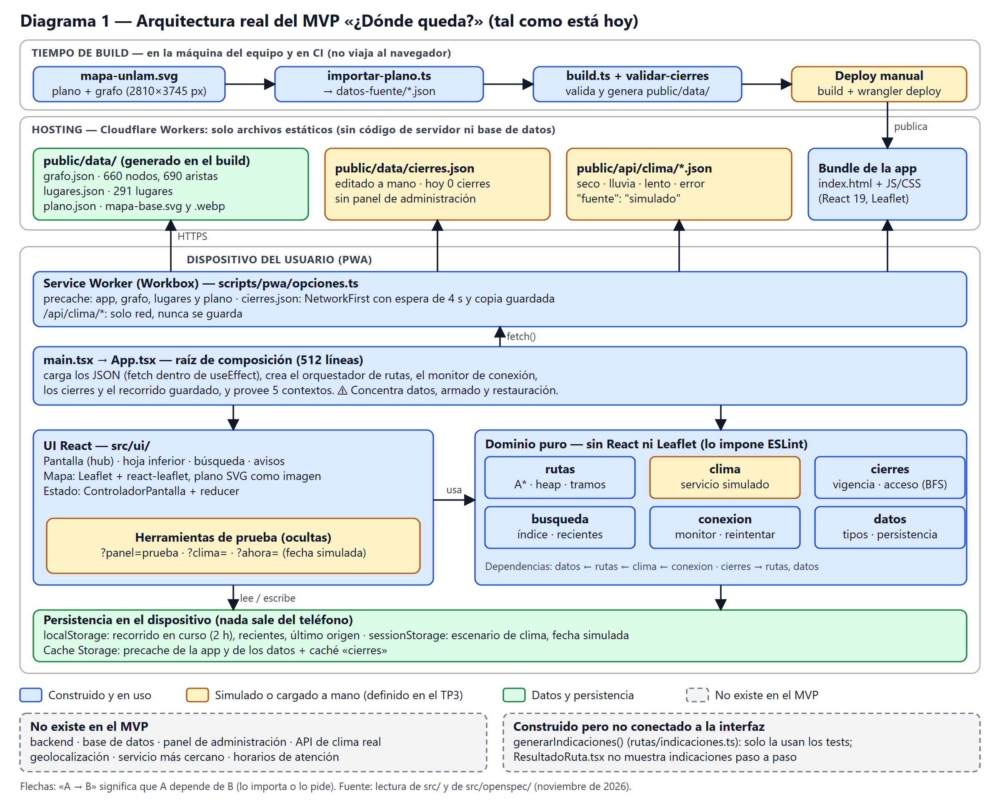

# TPI — Trabajo Práctico Integrador — Equipo Summate

> **BORRADOR para revisar en equipo.** Al cerrar el texto se borra esta nota y se genera `TPI-Summate.docx` y `TPI-Summate.pdf` con el formato de las entregas anteriores.

**Repositorio:** <https://github.com/gadsii-unlam/gadsii-summate>
**Producto funcionando:** <https://donde-queda.donde-queda.workers.dev>
**Integrantes:** Agasi Alejo, Huergo Estefanía, Naspleda Julián, Panigazzi Agustín, Rios Cristian
**Fecha de entrega y defensa:** 24/11/2026

**Nota sobre la numeración del brief.** El enunciado habla del brief "en su versión 5, que es la última". Nuestra numeración llegó a la versión 6 en el TP6 (la versión 5 es la del TP5, con el resultado de la prueba; la 6 le agrega la arquitectura). Ambas están en `docs/brief.md`, una debajo de la otra, y el documento sigue abriendo cada versión con su párrafo de cambios. Lo que el enunciado llama "versión 5" corresponde a nuestra versión 6.

---

## Parte 1 — El documento integrador

### 1. El arco

Este punto se escribió leyendo `docs/brief.md` versión por versión (`git show` de cada commit: v1 `f4d2d5a`, v2 `35f4b44`, v3 `718a410`, v4 `15eda3e`, v5 `6347a22`, v6 `ebcd996`), y no de memoria.

**Qué creíamos en agosto (versión 1).**

- **Producto:** una aplicación web con cinco funcionalidades: ruta más corta sobre un mapa, estado de atención de puntos de interés, servicio más cercano, administración de cierres y rutas adaptadas al clima con una API real.
- **Usuario:** un Navegante ingresante o de primer año, declarado «todavía hipotético»: «se apoya en la experiencia del equipo, pero aún no fue validado con usuarios reales». El segmento lo definíamos por haber pasado nosotros por esa etapa.
- **Supuestos:** cinco, con el 1 como crítico (los ingresantes tienen dificultades para encontrar aulas y servicios) y el 2 como la apuesta de valor (una ruta dibujada es más útil que un mapa estático). También dábamos por hecho que llevan celular con Internet (3), que los cierres rompen rutas conocidas (4) y que con lluvia prefieren ir por adentro aunque tarden más (5).

**Qué sabemos en noviembre (versiones 5 y 6).**

- **Producto:** quedó la función 1 completa (mapa y ruta), más la 4 (cierres) y la 5 (clima) en versión manual o simulada. Las funciones 2 y 3 nunca se construyeron. Después de la prueba del TP5 el producto se redefinió: no alcanza con dibujar la ruta hasta el edificio, hay que guiar hasta la puerta del aula.
- **Usuario real:** cinco encuestados (TP2) que van al campus una a cuatro veces por semana, llevan siempre el celular y tienen datos móviles con señal irregular. Cuatro de cinco llegaron tarde al menos una vez por no encontrar un lugar. Ese dato no estaba en la versión 1.
- **Supuestos:**

| # | Supuesto de agosto | Estado en noviembre |
| --- | --- | --- |
| 1 (crítico) | Dificultad para encontrar aulas y servicios | **Sobrevivió.** Confirmado en el TP2 y, en el TP5, U3 volvió a perderse dentro del edificio y a preguntarle a una persona. |
| 2 | Ruta dibujada más útil que mapa estático | **Sostenido en parte.** Siguieron la ruta sin ayuda hasta el edificio, pero nunca se comparó contra un mapa estático y adentro del edificio no alcanzó para 2 de 3. Sin evidencia de la comparación. |
| 3 | Celular con Internet | **Sobrevivió**, con un matiz: la señal es irregular (5 de 5). |
| 4 | Cierres vuelven incorrecta una ruta | **Sostenido en parte.** El cierre existe, pero 2 de 3 no lo miraron antes de empezar a caminar. |
| 5 | Prefieren ruta interior con lluvia | **Sin comprobar con lluvia real.** Con lluvia simulada, los tres caminaron la resguardada. |

Ningún supuesto se cayó del todo. Lo que cayó fue la **hipótesis de valor** que sostenían las versiones 2 a 4: en el TP5 solo 1 de 3 llegó solo a todos los destinos, y el criterio que escribimos antes de la prueba la declaraba refutada con 1 de 3 o menos.

**El momento en que más cambió el rumbo: la prueba del TP5 (versión 5).** Lo provocó el contraste entre lo que pasó en la parte exterior del recorrido y lo que pasó adentro:

- Los tres usuarios llegaron al edificio siguiendo la ruta (9 de 9 tareas llegaron a la puerta; 8 de 9 sin pedir indicaciones).
- Lo que falló fue el último tramo: U2 subió sin leer el piso (T1, 17:03:30) y U3 siguió de largo, dio una vuelta mirando los carteles y le preguntó a una persona (T1, 18:03:40 a 18:06:15).
- Los dos nombraron lo mismo al final: «Que me dijera más claro en qué piso» (U3).

Pasamos de «mostrar una ruta» a «guiar hasta la puerta del aula y mostrar el cierre antes de empezar a caminar», con un pivote de necesidad del consumidor. Un giro menor y anterior fue el recorte del TP3 (versión 3), que dejó afuera el panel de cierres, la API real de clima y las funciones 2 y 3.

### 2. El estado del producto

**Qué es y para quién.** _¿Dónde queda?_ es una aplicación web móvil que calcula y dibuja la ruta más corta entre dos puntos del campus de la UNLaM. Resuelve la desorientación de los ingresantes y estudiantes de primer año, que pierden entre cinco y diez minutos y llegan tarde cuando no encuentran un aula o sector.

**Qué está construido y funcionando.**

- Selección de origen y destino, búsqueda y recientes.
- Cálculo de la ruta más corta con A\* en el teléfono, sobre un grafo del campus de 660 nodos y 690 aristas, con las entradas de los edificios marcadas con flechas en el plano.
- Exclusión de tramos cerrados y alternativa «resguardada» con lluvia.
- PWA que sigue mostrando la ruta cargada si se corta la señal.

Está publicado en Cloudflare Workers, y el deploy es automático con GitHub Actions. Cada push corre lint, chequeo de tipos, tests unitarios, la validación de `cierres.json` contra el grafo y los tests E2E en Chromium móvil. Si el push es a `main` y todo pasa, se publica solo. En las demás ramas y en los pull requests corren las mismas verificaciones, sin deploy. Se comprobó en la URL pública que responde, que el grafo publicado tiene 660 nodos y 690 aristas, que `cierres.json` está vacío, que los cuatro archivos del clima simulado (`seco`, `lluvia`, `lento` y `error`) están en `/api/clima/` y que el código publicado trae los textos «Sin acceso ahora», «Buscando el camino…», «Sin conexión» y «Reintentar». Además se recorrió a mano el MVP publicado en Chrome:

- **Ayuda de primer uso:** al abrir aparece «Para empezar» con el botón «Entendido».
- **Ruta sin botón de cálculo:** Entrada Florencio Varela → Aula 255 se calcula sola al elegir el destino, y «Iniciar» acerca el mapa al origen.
- **Lluvia simulada:** con el panel de prueba (`?panel=prueba`, Clima simulado → Lluvia) Buffet → Aula 108 pasa a «Llueve · te recomendamos la ruta más resguardada», y la más rápida sigue disponible.

El MVP no da indicaciones paso a paso y no contempla edificios de más de un piso. El camino se sigue en el mapa, y las entradas de los edificios están marcadas con flechas. La indicación de piso es justamente lo que el TP5 detectó que faltaba y lo que el pivote propone construir. En esa sesión no se probaron la vista de celular ni «Sin conexión».

**Qué quedó simulado.**

- El clima, que se lee de archivos JSON fijos en lugar de una API real.
- Los cierres, que se cargan a mano en `cierres.json` y se publican al subir el cambio a `main`. El deploy ya es automático, pero cargar un cierre sigue exigiendo tocar el repositorio. El de T2 se cargó para la prueba y se retiró después, por eso el archivo versionado está vacío.

**Qué quedó diferido.**

- El panel de administración de cierres.
- Los horarios de atención de puntos de interés y el servicio más cercano (funciones 2 y 3).
- El backend con autenticación y base de datos.

**Resultado de la prueba con usuarios del TP5 y qué se hizo con él.** U1, U2 y U3 resolvieron tres tareas en el campus.

| | Resultado | Condición para sostener | ¿Se cumple? |
| --- | --- | --- | --- |
| M1: llegaron solos a las tres tareas (≤ 5 min, sin pedir indicaciones ni tomar el tramo cerrado) | 1 de 3 (U1) | al menos 2 | No. Cumple la condición de refutación. |
| M2: caminaron el desvío en T2 sin acercarse al cierre | 1 de 3 (U1) | al menos 2 | No. La refutación por M2 no se cumple. |

- **Estado de la hipótesis:** refutada por M1. La lectura tiene dos límites: son tres usuarios, y M1 depende de dónde empieza el reloj (desde que aparece la ruta, M1 daría 2 de 3).
- **Qué hicimos:** pivotar con un pivote de necesidad del consumidor. La nueva hipótesis es que los ingresantes llegan al edificio sin dificultad con la ruta, y que el tiempo se pierde orientándose dentro (piso, pasillo, puerta del aula). Lo primero a construir sería una guía de llegada de la entrada del edificio a la puerta del aula y el aviso del cierre antes de empezar a caminar. La nueva hipótesis **todavía no se probó**.

**La arquitectura.**

_Azul: construido. Ámbar: simulado o manual. Verde: datos. Fuente: TP6, diagrama 1. El diagrama de la gran visión está en `docs/arquitectura/diagramas/gran-vision.png`._

SPA con React, TypeScript y Vite, instalable como PWA y sin backend. La ruta se calcula en el teléfono y los datos son archivos estáticos publicados en Cloudflare Workers. Lo único que se guarda está en el dispositivo.

### 3. Las decisiones

Cinco decisiones, una por eje (quién, qué, cómo se usa, con qué y cómo se mide) para que no se pisen entre sí. La decisión de pivotar no tiene fila aparte: es la consecuencia de la quinta y ya está contada en los puntos 1 y 2.

| # | Decisión | Qué la fundamentó | Qué se resignó | ¿La sostienen hoy? |
| --- | --- | --- | --- | --- |
| 1 | **Quién:** el usuario primario es el Navegante ingresante o de primer año, y no el administrador ni la comunidad en general (TP1). | TP2: 4 de 5 no encontraron un aula o sector entre dos y seis veces, perdieron entre cinco y diez minutos y llegaron tarde al menos una vez. | Diseñar para el administrador y para estudiantes avanzados o personal. | **Sí.** En el TP5 volvió a confirmarse el supuesto crítico. El matiz está en la decisión 5 (cómo elegimos a quién probar). |
| 2 | **Qué:** recorte funcional del MVP (TP3): solo la ruta más corta, con cierres precargados y clima simulado. Fuera, el panel de cierres, la API real, los horarios y el servicio más cercano. | El MVP existe para probar la hipótesis de valor (llegar sin pedir indicaciones ni tomar un acceso cerrado), y para eso no hacen falta las otras funciones. | Probar el clima real y dos de las cinco funciones del producto original. | **Sí, para el MVP.** Pero el cierre cargado a mano obligó a dos deploys en la prueba (ver decisión 4). |
| 3 | **Cómo se usa:** estructura B, mapa único con panel (eficiencia), en lugar de A (asistente de pasos) o C (confirmaciones) (TP3). | TP2: la consulta ocurre antes de una clase o examen con poco margen, y con señal irregular una sola carga es mejor que cinco pantallas. Detalle en `docs/diseno/propuesta-final.md`. | Facilidad de aprendizaje en el primer uso y una pantalla de revisión previa. | **En parte.** El TP4 mostró que el origen precargado podía llevar a un punto de partida equivocado: lo mantuvimos como sugerencia que hay que confirmar y sumamos ayuda breve. Y el TP5 falló en seguir la ruta adentro del edificio. |
| 4 | **Con qué:** arquitectura sin backend: ruta calculada en el teléfono, PWA y datos como archivos estáticos con deploy (TP5). La propuso la herramienta, no el equipo. | TP2: 5 de 5 tienen datos móviles con señal irregular. En el TP5, U3 perdió la señal 20 s y la ruta cargada siguió a la vista. | Cargar datos sin tocar código y tener los cierres al día: el cierre de T2 requirió cargarlo el día anterior, publicar, y retirarlo y volver a publicar. | **Para el MVP sí, para la visión no.** Un cierre real no puede esperar a un deploy (TP6). El deploy automático acorta la espera, pero no saca el cierre del repositorio. |
| 5 | **Cómo se mide:** el criterio de éxito del TP5: M1 con umbral fijo de 5 minutos desde la entrega del celular, 2 de 3 para sostener, probado con U1 a U3. | Lo escribimos y commiteamos antes de la prueba para no ajustarlo al resultado. Elegimos 2 de 3 porque con tres personas no se puede pedir el 80 % del criterio original (4 de 5). | Un umbral que sirviera para destinos de distinta distancia, y probar con gente que no conociera el campus. | **No, esta es la que cambiaríamos.** Ver abajo. |

**La que hoy cambiaríamos: la decisión 5.** Tiene tres defectos que se vieron recién con la evidencia:

- **El umbral de 5 minutos es fijo.** El campus es grande y no todos los destinos están a la misma distancia. Un tiempo único castiga el destino lejano y premia el cercano.
- **El reloj arranca en la entrega del celular.** Con otro punto de partida (desde que aparece la ruta), M1 pasa de 1 de 3 a 2 de 3. La decisión de pivotar se apoyó en el patrón (dos de tres con dificultad en el mismo lugar), no en el número.
- **Los usuarios ya conocían parte del campus.** Eran tres de los cinco encuestados del TP2, que iban de una a cuatro veces por semana. U2 conocía el Aula 108 y hubo que cambiarle la tarea a la 112, y en T2 dijo «Primero fui por el camino más directo, que es el que yo conozco», justo lo que lo llevó a la cinta. El segmento sigue siendo el correcto (ingresantes y primer año), pero probamos con quienes ya llevaban un cuatrimestre.

Hoy mediríamos la llegada a la puerta con un tiempo proporcional a la distancia y sumaríamos a ingresantes en sus primeras semanas.

### 4. Qué falta

Si el producto saliera a producción en el ámbito de la UNLaM:

**¿Qué habría que construir que hoy está simulado?**

- Un backend con autenticación y una base persistente (la visión propone Cloudflare Workers + D1) y un panel donde un administrador cargue los cierres con vigencia.
- La API meteorológica real, que reemplaza al servicio simulado. En el código, `src/clima/servicio-simulado.ts` es lo único que habría que cambiar.
- La sincronización de cierres entre servidor y PWA por versión del dato (ETag).
- Las funciones 2 y 3, que nunca se construyeron.
- La guía de llegada dentro del edificio del pivote (piso, pasillo y puerta del aula), que hoy no existe: el MVP solo marca las entradas con flechas. Como punto de partida, en el repositorio quedó el generador de indicaciones que se sacó del MVP (`src/src/rutas/indicaciones.ts`). La interfaz no lo usa.

**¿Qué riesgo del TP6 habría que resolver primero?** El subsistema de cierres. Hoy es un archivo editado a mano y un push a `main` que dispara el deploy, y con señal irregular la app puede mostrar una copia vieja sin avisar. Además, en el TP5 dos de tres usuarios no miraron el cierre hasta llegar a la cinta, aunque el desvío estaba en pantalla. Antes del backend, el aviso del cierre tiene que verse antes de empezar a caminar.

**¿Quién lo mantendría y qué haría falta?** No lo sabemos y lo declaramos como límite: ningún TP relevó sistemas, políticas de acceso a datos ni responsables en la UNLaM. Hoy lo mantiene el equipo, y los cierres los carga quien edita el archivo y lo sube a `main`. Para que lo tome un rol de la universidad haría falta:

- **Documentación:** ya existen `src/README.md`, la guía `src/docs/cierres.md` y los `design.md` de OpenSpec. Faltaría un manual para quien carga cierres sin tocar código.
- **Accesos:** la cuenta de Cloudflare, el repositorio con los secrets del deploy en GitHub Actions, y una fuente institucional de datos del plano, que hoy es un SVG propio del equipo.
- **Capacitación:** para el rol que cargue los cierres.
- **Presupuesto:** las funciones del MVP no necesitan backend, y el hosting estático es gratuito. La versión final sí lo necesita, para el panel de cierres y la API de clima, pero el costo seguiría siendo muy bajo. Con el volumen de un campus, el plan gratuito de Cloudflare Workers y D1 alcanza (5 GB y 100.000 escrituras por día). Si hiciera falta superarlo, el plan pago cuesta US$ 5 por mes. Open-Meteo es gratuito para uso no comercial hasta 10.000 consultas por día. Con una consulta cacheada cada 15 minutos, se harían unas 100 por día. Es una estimación sobre precios publicados (noviembre de 2026), no un presupuesto relevado con la UNLaM.

**Deuda técnica.**

| | Deuda | Deliberada |
| --- | --- | --- |
| Sí | Sin backend, clima simulado, cierres cargados a mano, sin funciones 2 y 3, plano propio del campus en SVG. | Decisiones de alcance del TP3 que el equipo tomó para probar la hipótesis. |
| Sí, pero heredada | Sin backend: la decisión la tomó la herramienta. | El equipo había decidido no hacer panel; la herramienta eligió el mecanismo. |
| No | `App.tsx` de 512 líneas que hace los fetch, arma el orquestador, el monitor de conexión y los cierres, restaura el recorrido y provee 5 contextos. | Nadie lo decidió: salió de sumar cambios de OpenSpec uno tras otro. |
| No | El CI corre los E2E solo en Chromium móvil: los de WebKit (Safari de iPhone) se siguen corriendo a mano. | Nadie lo decidió. |
| No | Ningún dato institucional relevado sobre infraestructura o mantenimiento. | Nadie lo decidió. |

### 5. La retrospectiva del trabajo con IA

Las respuestas se apoyan en `docs/prompts.md` (la línea indica la fila de la tabla).

**¿Dónde la IA ahorró trabajo real?**

- **El MVP del TP5 (líneas 20 a 22).** Con Claude Code y el flujo de OpenSpec se construyeron ocho cambios (`src/openspec/changes/`): datos del campus, ruta con A\*, interfaz móvil, indicaciones, cierres, clima simulado, tolerancia a señal irregular y base de la app. Incluye el pipeline que genera el grafo desde el plano SVG, el CI y los tests. Sin la herramienta, un MVP de este tamaño no entraba en el tiempo de un TP.
- **La evaluación heurística del TP4 (línea 15).** La IA revisó más variantes del wireframe que nosotros y encontró tres problemas que no habíamos visto (una novedad que abre una materia incorrecta, materias que no se pueden abrir, botones chicos).
- **Los documentos de las entregas** (docx y PDF con el formato de las entregas anteriores) y los diagramas del TP6.

**¿Dónde la IA nos llevó por el camino equivocado?**

- **El origen precargado de la alternativa B (línea 12).** Diseñada con IA, optimizaba pasos («dos toques») y por eso proponía el último origen ya elegido. Era correcto en general e inadecuado para nuestro usuario: un ingresante no conoce los nombres del campus, y un origen equivocado devuelve el tiempo ahorrado.
- **El guion y las planillas del TP5 (líneas 22 a 24).** Salieron con grabaciones, roles de integrantes, columnas de «Capa» y «Severidad» y ejemplos de notas inventados. Hubo que sacarlos: la consigna no los pedía y no teníamos grabaciones.
- **La arquitectura sin backend y la concentración de la composición en `App.tsx`.** La IA las decidió (o salieron de su forma de ir sumando cambios) y no las discutimos. En el TP6 nos dimos cuenta de que no las habíamos elegido.
- **El diagrama de la gran visión del TP6 (línea 30).** Quedaban dentro del recuadro del MVP el servicio más cercano y los horarios, que nunca se construyeron.

**¿Cuál fue el descarte más importante?** Las indicaciones paso a paso y los edificios de más de un piso. Claude Code los construyó dentro del MVP (cambio `mostrar-ruta-e-indicaciones`, con pasos como «doblar», «entrar al edificio» o «subir al piso»). El equipo los sacó antes de la prueba para no sumarle complejidad al MVP, y quedó solo la ruta dibujada con las flechas de entrada. Fue un descarte por alcance, no por evidencia, y la prueba del TP5 mostró su costo. Los dos usuarios que fallaron lo hicieron justo adentro del edificio: U2 subió sin leer el piso y U3 pidió «que me dijera más claro en qué piso». Lo que sacamos para simplificar es lo que hoy propone construir el pivote. El código quedó en el repositorio (`src/src/rutas/indicaciones.ts`), pero la interfaz no lo usa.

**¿Qué haríamos distinto si empezáramos mañana con las mismas herramientas?**

- Registrar en `prompts.md` también lo que rechazamos, y no solo lo que pedimos: hoy la tabla casi no tiene descartes y este punto se escribió reconstruyéndolos.
- Decidir la arquitectura antes de delegarla y escribirla como decisión del equipo, con su alternativa descartada.
- Escribir el criterio de éxito con alguien de afuera, para que no copie nuestro sesgo (decisión 5).

---

## Parte 2 — El repositorio

| Requisito del enunciado | Estado hoy | Qué falta |
| --- | --- | --- |
| Tags de todas las líneas base, incluida la del TPI | Hay un solo tag, `tp4-entrega`, y apunta al merge del TP3 (`25315ab`), no al del TP4. Es el tag que se informó al equipo que nos evaluó, por eso no se mueve. | Ver abajo. |
| README: qué es, cómo se ejecuta y cómo se continúa | Dice qué es y enlaza el MVP y la documentación. Cómo se ejecuta está en `src/README.md`. | Sección «Cómo se continúa»: qué sigue (guía de llegada y aviso del cierre), dónde está cada decisión, quién carga los cierres. |
| Brief en su versión 5 | `docs/brief.md` tiene hasta la versión 6. | Declarado arriba la equivalencia de numeración. |
| Registro de prompts completo | Sí, con entradas hasta el TP6 y la de las correcciones. | Entrada del TPI. |
| Evidencia del TP2 y del TP5 | Sí, en `docs/evidencia/tp2/` y `docs/evidencia/tp5/`. | — |

**Las líneas base y los tags.** El TP7 no se hizo (la cátedra lo dejó de lado por tiempos), así que nunca se definió una convención de tags. Se propone la de la clase de Gestión de Configuración, con tags anotados y versionado semántico, en el mismo orden de entregas.

| Línea base | Hito | Commit candidato | Tag |
| --- | --- | --- | --- |
| LB1 | Entrega del TP1 | `42a4411` | `v0.1.0` |
| LB2 | Entrega del TP2 | `35f4b44` | `v0.2.0` |
| LB3 | Entrega del TP3 | `25315ab` | `v0.3.0` |
| LB4 | Entrega del TP4 | `25315ab`, el que ya señala `tp4-entrega` y se le informó al equipo evaluador | `v0.3.1` |
| LB5 | Entrega del TP5, MVP funcionando | `00d1d3f` | `v1.0.0` |
| LB6 | Entrega del TP6 | `cf269cf` | `v1.1.0` |
| LB7 | TP7 | No existe: el TP7 no se hizo | — |
| LB8 | Entrega del TPI | el commit final del TPI | `v1.2.0` |

Los tags no se crean ni se suben hasta que el equipo confirme.

---

## Límites: lo que no llegamos a hacer ni pudimos verificar

- La **hipótesis nueva** (la guía de llegada) no se probó.
- La prueba fue con **tres usuarios**, sin significancia estadística, y no incluyó a U4 ni a U5 del TP2.
- La **lluvia fue imaginada** por los usuarios y simulada en la aplicación; el **cierre de T2 lo señalizó el equipo con una cinta**, por lo que M2 puede sobrestimar.
- El **supuesto 2 nunca se comparó** contra un mapa estático: queda sin evidencia.
- **No relevamos** la infraestructura de la UNLaM ni quién mantendría el producto.
- El **TP7 no se hizo**: las líneas base no tenían tags hasta el TPI.
- **Fechas de la evidencia del TP5:** el informe del TP5 dice que el criterio de éxito se escribió y commiteó antes de la prueba. En git, el commit del criterio (`66ffe3b`) y el del MVP (`113f1c1`) son posteriores a las sesiones que figuran en el registro. El criterio se acordó internamente antes de las sesiones, pero se plasmó por escrito recién cuando el equipo tuvo todo lo necesario para completar el TP; por eso el historial de git no lo prueba y la afirmación del informe es más fuerte de lo que el repositorio sostiene.
